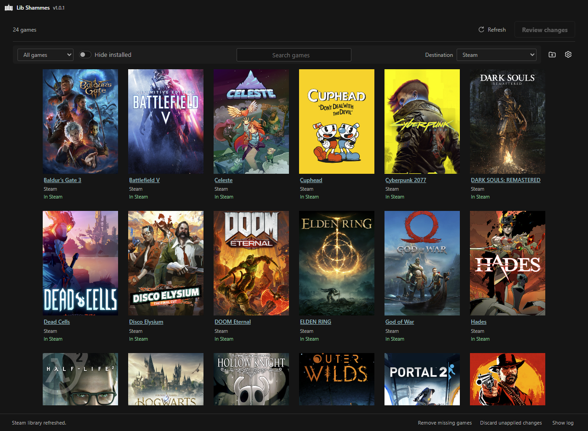
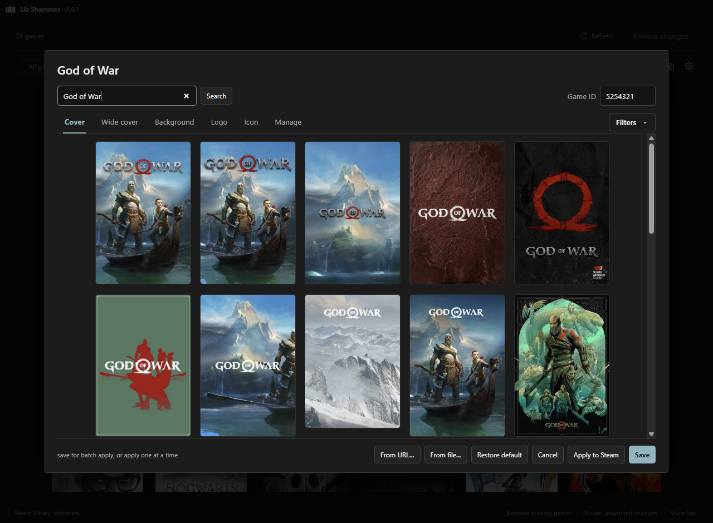

# Lib Shammes

Lib Shammes is an app made to customize and modify your Steam game artwork using SteamGridDB.

It can also scan your game folders, find installed games, and add them as non-Steam shortcuts. You can choose their artwork before adding them.

## Screenshots

<p align="center">
  <a href="docs/screenshots/steam-library.png"></a>
  <a href="docs/screenshots/artwork-picker.png"></a>
</p>

## Install

[Windows installer is here](https://github.com/Kirkland-Pickles/lib-shammes/releases/latest).
Windows only.

## How to use

Your Steam library appears automatically. Open a game to change its artwork.

Add [SteamGridDB API key](https://www.steamgriddb.com/profile/preferences/api) to browse artwork. Or use your own images without a key.

Choose artwork for each game, then save your choices and use **Review changes** to apply them together. Steam will close while changes are applied and reopen afterwards.

For games outside Steam, use , choose a game’s folder or a folder containing multiple games. Review the name, launcher and game match before adding them to Steam.

To manage Desktop or Start-menu shortcuts, change **Destination**. These don’t require Steam.

## Undoing changes

Use **Purge** to undo the changes made by Lib Shammes. It uses a saved
record of those changes for this purpose. Steam's shortcut
file is backed up before anything is changed.

Do this before using **Delete app data** if you want the changes undone. Deleting
the app data removes that saved record too.

## Building

Install Node.js LTS, then run:

```bat
npm ci
npm run build
```

The installer will be in `dist\`.

## Help

[Open an issue](https://github.com/Kirkland-Pickles/lib-shammes/issues) for bugs
or suggestions.

## Credits

- Game matching and artwork: https://www.steamgriddb.com/
- Layout inspiration and artwork-selection flow: https://github.com/SteamGridDB/decky-steamgriddb

