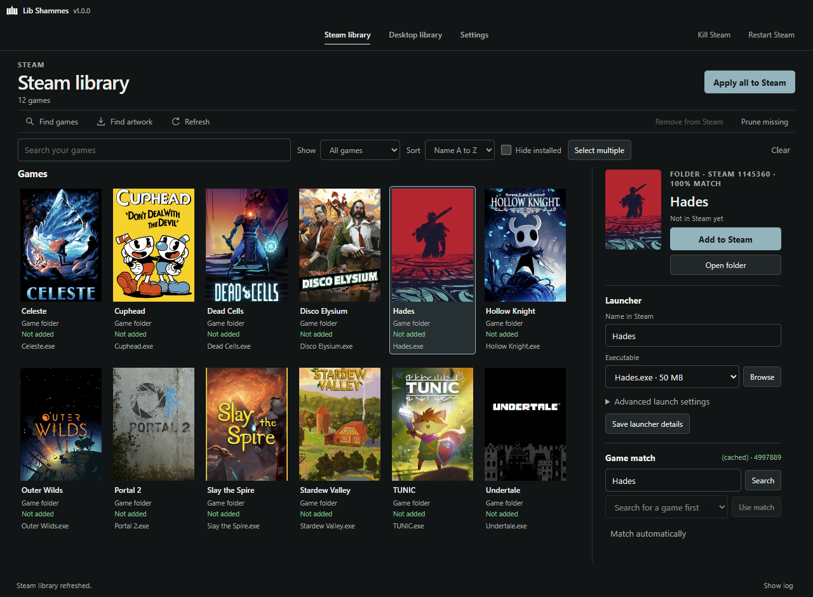
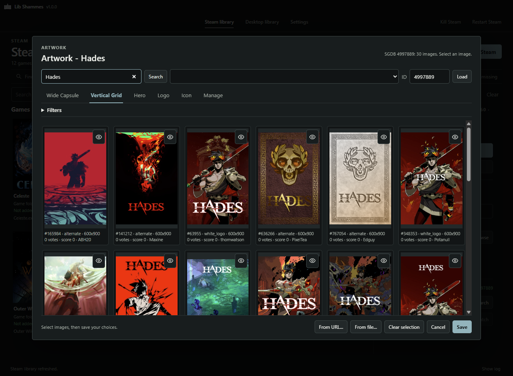

# Lib Shammes

Lib Shammes is an app made to customize and modify your steam game artwork using SteamGridDB.

It is also for portable games and games installed from sources other than steam. It scans your game folders and finds installed games based on name matching and folder structure, then adds them as non-Steam shortcuts with filled in artwork via SteamGridDB, so you don't have to add everything one at a time.

## Screenshots

<p align="center">
  &nbsp;&nbsp;&nbsp;
</p>

## Install

[Windows installer is here](https://github.com/Kirkland-Pickles/lib-shammes/releases/latest).
Windows only.

## How to use

Get a
[SteamGridDB API key](https://www.steamgriddb.com/profile/preferences/api) for
online matching and artwork. You can skip the key and use your own images if you want.

Add your game folders and scan them.
Check the results before adding them to Steam, especially if a folder has more
than one launcher. You can change the name, pick another executable or correct
the game match if it got something wrong.

For artwork, you can let it pick the images or choose them yourself in the
artwork picker. Then use **Apply all to Steam**, or **Select multiple** first if
you only want certain games. Apply all uses the games shown by your current
filters. Steam will close to apply the changes and reopen if it was running.

Desktop and Start-menu shortcuts are supported too, and don't need Steam.

## Undoing changes

Use **Purge** to undo the changes made by Lib Shammes. It uses a saved
record of those changes for this purpose. Steam's shortcut
file is also backed up before it's changed.

Do this before using **Delete app data** if you want the changes undone. Deleting
the app data removes that saved record too.

## Building

Install Node.js LTS, then run:

```bat
npm ci
npm run build
```

The installer will be in `dist\`.

## Help

[Open an issue](https://github.com/Kirkland-Pickles/lib-shammes/issues) for bugs
or suggestions.

## Credits

- SteamGridDB for the game matching and artwork: https://www.steamgriddb.com/

